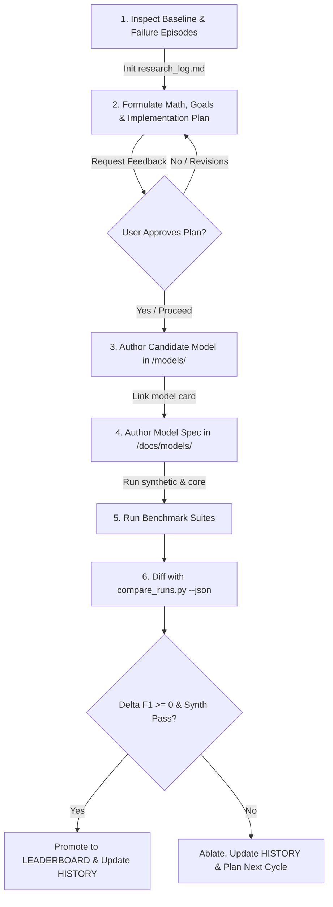

# Vialactée Autonomous Research Agent Skill

Use this skill whenever you are tasked with conducting Music Information Retrieval (MIR) research, evaluating or tuning beat tracking algorithms, creating candidate models, investigating failure episodes, or benchmarking against the neural ground-truth suite in `/research/`.

---

## 1. Core Principles & Safety Invariants

### 1.0 Musical Scope & Domain Focus (Electro, Techno, Rock, Pop)
- **Target Genres Only:** The Vialactée chandelier is designed for dynamic nightlife, immersive visual shows, and high-energy music listening. Research and algorithmic tuning must **strictly focus on Electro, Techno, Synthwave, Rock, and Pop** songs.
- **Do Not Divert:** Never divert research effort onto acoustic chanson, slow jazz waltzes, or obscure complex polyrhythmic acoustic music.
- **The Curated 10-Track `neural-core` Suite:** The standard real-world evaluation suite is composed exclusively of representative tracks across these core genres:
  - **Electro / Techno / Synthwave:** `Genesis` (Justice), `Nightcall` (Kavinsky), `Roadgame` (Kavinsky)
  - **Rock / Hard Rock:** `Bohemian Rhapsody - Remastered 2011`, `Roxanne - Remastered 2003`, `Sweet Child O' Mine`, `Under Pressure - Remastered 2011`
  - **Pop / Pop-Rock:** `Pumped Up Kicks`, `Where Is My Mind_`, `Stayin' Alive - From _Saturday Night Fever_ Soundtrack`

### 1.1 The Real-Time Embedded Constraint ($\le 3.0\text{ms}$)
- **Canonical authority:** [`docs/axioms/AXIOM-01_FRAME_BUDGET.md`](../../../docs/axioms/AXIOM-01_FRAME_BUDGET.md). The chandelier **renders at 30 FPS** ($33.33\text{ms}$ frame, $\le 20.0\text{ms}$ total compute) on a **Raspberry Pi 4 / 5**. Never describe production as "60 FPS".
- The audio onset/analyzer layer is decoupled and **ticks at 60 Hz** ($16.67\text{ms}$ hop, 735 samples @ 44.1 kHz). Benchmarks call `update()` once per 60 Hz tick, and `avg_frame_time_ms` in the scorecard is **per tick**.
- Research gate: audio ingestion + Beat Tracking + Novelty Detection must stay $\le 3.0\text{ms}$ **per `update()` tick** on ARM Cortex-A72 (a conservative gate: AXIOM-01 allots $\le 3.5\text{ms}$ of audio DSP per 30 FPS render frame, and current models run well under $1\text{ms}$ per tick).
- **Zero Dynamic Heap Allocation:** Never allocate new arrays or resize buffers in per-frame `update()`. All arrays must be pre-allocated NumPy buffers initialized in `__init__()`.
- **Pure Vectorization:** Use compiled NumPy matrix math (`np.dot`, `np.convolve`, slicing). Never write Python `for` loops over raw audio sample buffers.

### 1.2 The Zero-Regression Policy
- Any candidate model proposed for promotion to production (`core/AudioAnalyzer.py`) must pass the **clean-room synthetic suite** (`--suite synthetic`) with **$\Delta \text{F1@50ms} \ge 0.0\%$**.
- A candidate that improves complex syncopated tracks but causes double-trigger chatter or phase lag on steady click tracks will be rejected.

### 1.3 Agent Execution & Workflow Guardrails
- **No Background Polling Loop:** Benchmark suites take ~15s (`synthetic`) to ~45s (`neural-core`). Always launch benchmarks with `WaitMsBeforeAsync=10000`. If a task is sent to the background, **DO NOT poll with `manage_task(Action='status')` or set short timers with `schedule` in a loop**. Simply end your turn and let the system deliver the reactive task completion notification.
- **Subagents: Pure Reactive Wakeup (No Timers or Polling):** When you spawn subagents with `invoke_subagent`, the system resumes your execution **automatically** as soon as a subagent finishes or sends a message. **NEVER call `schedule` to set a check-in timer, and NEVER call `manage_subagents(Action='list')` to check if a subagent is done.** Simply end your turn or proceed with other independent work; the platform will deliver the subagent's response directly to your inbox.
- **Windows / PowerShell, scorecard keys, benchmark exit codes:** see [`references/scorecard_and_guardrails.md`](references/scorecard_and_guardrails.md) (read before parsing `scorecard.json` or running `compare_runs.py`; exit code 1 = regression signal, not a crash).

### 1.4 The Living Research Artifact Invariant (`research_log.md`)
- For **every** research cycle, the agent **MUST** initialize and maintain a living user-facing markdown artifact:
  `<appDataDir>\brain\<conversation-id>/research_log.md` (ArtifactMetadata: `UserFacing: true`, `RequestFeedback: false`).
- **Incremental Chronological Updates:** The artifact must NOT be created only at the end. Update it progressively as each phase finishes:
  1. **Phase 1 (Orientation):** Append literature review, baseline scorecard, inspected failure episodes, and target musical styles.
  2. **Phase 2 (Hypothesis):** Append mathematical rationale, target equations, and failure modes to resolve.
  3. **Phase 3 (Architecture):** Append candidate buffer design, vectorized update rules, and $\le 3.0\text{ms}$ budget verification.
  4. **Phase 4 (Model Card):** Reference the newly authored `research/docs/models/<CandidateName>.md`.
  5. **Phase 5 (Benchmarks):** Append synthetic scorecard table (zero-regression check) and real-world (`neural-core`) scorecard table.
  6. **Phase 6 (Diagnostics & Decision):** Append single-track comparisons, ablation tables, final decision (Promote vs Reject), and lessons learned.
- Refer to [`research/docs/templates/RESEARCH_CYCLE_ARTIFACT_TEMPLATE.md`](file:///c:/Users/Users/Desktop/vialactée/vialactee/research/docs/templates/RESEARCH_CYCLE_ARTIFACT_TEMPLATE.md) for the standard structure.

---

## 2. The 6-Step Autonomous Scientific Loop



### Step 1: Literature & Diagnostic Inspection
1. Read the latest entries in [`research/experiments/RESEARCH_HISTORY.md`](file:///c:/Users/Users/Desktop/vialactée/vialactee/research/experiments/RESEARCH_HISTORY.md) to understand current state of the art and past dead ends.
2. Read the baseline scorecard in [`research/experiments/runs/`](file:///c:/Users/Users/Desktop/vialactée/vialactee/research/experiments/runs/) and inspect `failure_episodes.json` to identify active error types (`PHASE_INVERSION_UPBEAT`, `GHOST_BEAT_BURST`, `HIGH_PHASE_JITTER`).
3. Check [`research/benchmarks/ground_truth/music_catalog.json`](file:///c:/Users/Users/Desktop/vialactée/vialactee/research/benchmarks/ground_truth/music_catalog.json) to correlate failures with musical style (e.g. 180° upbeat traps in Disco/Funk vs 3/4 drift in Chanson).
4. **Inspect target tracks directly with diagnostic tools:**
   ```bash
   # Quick diagnostic of a single failing track:
   python -m research.benchmarks.diagnose_track --track "Stayin' Alive"
   
   # Visual 4-tier plot of waveform, flux, phase sawtooth, and failure zones:
   python -m research.benchmarks.plot_diagnostics --audio "research/benchmarks/audio/Stayin' Alive.mp3" --beats "research/benchmarks/ground_truth/neural/Stayin' Alive - From _Saturday Night Fever_ Soundtrack.beats.txt" --output "research/experiments/diagnostics_stayin_alive.png"
   ```
5. **Initialize Living Artifact:** Create `<appDataDir>\brain\<conversation-id>/research_log.md` (ArtifactMetadata: `UserFacing: true`, `RequestFeedback: false`) with the Section 1 Orientation summary.

### Step 2: Formulate Math, Goals & Create Implementation Plan (Dual-Mode Approval Gate)
1. **Mathematical Formulation & Goals:** Formulate a rigorous mathematical hypothesis and concrete goals:
   - State the governing equations in LaTeX (e.g. difference equations, resonator matrix geometry, Hilbert quadrature).
   - Define exact quantitative goals (e.g. *"Lift Rock F1 from 41.1% to $\ge 60.0\%$ on Sweet Child O' Mine while preserving 0.20ms CPU latency"*).
   - If needed, delegate mathematical prototyping to a subagent (`invoke_subagent`) to verify equations in `<appDataDir>/brain/<conversation-id>/scratch/` before drafting the plan.
2. **Author the Implementation Plan Artifact:**
   Create `<appDataDir>\brain\<conversation-id>/implementation_plan.md`:
   - Detailed sections:
     - **Problem & Baseline Failure Modes**
     - **Mathematical Formulations & DSP Equations** (in rigorous LaTeX)
     - **Quantitative Goals & Success Criteria**
     - **Proposed Code Changes** (Model file, Model Card, Configs)
     - **Verification Plan** (Synthetic clean-room zero-regression gate, `neural-core` 10 tracks)
3. **APPROVAL GATE (Dual-Mode Operation):**
   - **Mode A: Interactive Standalone Mode (Human-Driven):**
     - Set `ArtifactMetadata: RequestFeedback: true, UserFacing: true`.
     - **STOP calling tools and yield the turn.**
     - Ask the user to review and approve the implementation plan before writing any model code or running heavy benchmarks.
     - **Do NOT proceed to Step 3 until the user explicitly approves the plan** (e.g. clicks "Proceed" or gives confirmation).
   - **Mode B: Autopilot Worker Mode (Supervised by Research Manager or `/goal`):**
     - Set `ArtifactMetadata: RequestFeedback: false, UserFacing: true` (ensures the IDE UI modal does not block).
     - Send the mathematical implementation plan directly to the parent Research Manager via `send_message`.
     - Upon receiving the confirmation message (`"APPROVED: Proceed..."`), proceed immediately to Step 3 without halting.
4. **Update Artifact:** Append the approved hypothesis and mathematical equations to `research_log.md`.

### Step 3: Implement Candidate Model
1. Create a new model file: `research/experiments/models/<CandidateName>.py`.
2. Must inherit from `BaseAudioAnalyzer` and implement the standard constructor:
   ```python
   from typing import Dict, Any, Optional
   from core.BaseAudioAnalyzer import BaseAudioAnalyzer
   from core.RhythmConfig import RhythmConfig

   class CandidateModel(BaseAudioAnalyzer):
       def __init__(
           self,
           ingestion: Any = None,
           infos: Optional[Dict[str, Any]] = None,
           config: Optional[RhythmConfig] = None
       ) -> None:
           super().__init__(ingestion=ingestion, infos=infos, config=config)
           self.config = config or RhythmConfig()
   ```
3. Implement `reset()`, `update(current_time, dt, fps_ratio)`, and `capture_frame_telemetry()`.
4. **Update Artifact:** Append model architecture notes and buffer pre-allocation details to `research_log.md`.

### Step 4: Write Model Documentation
1. Copy [`research/docs/models/MODEL_CARD_TEMPLATE.md`](file:///c:/Users/Users/Desktop/vialactée/vialactee/research/docs/models/MODEL_CARD_TEMPLATE.md) to `research/docs/models/<CandidateName>.md` and document the mathematical equations ($ODF$, phase flywheel, template scoring), hyperparameters, and target failure modes.
2. **Update Artifact:** Link model documentation card in `research_log.md`.

### Step 5: Benchmark Execution
Use the curated `neural-core` suite for rapid iteration, and `synthetic` for regression verification:

```bash
# Rapid test on neural-core (~30-45 seconds)
python -m research.benchmarks.run_benchmark --model <CandidateName> --suite neural-core --save-run --name test_attempt_1

# Clean-room synthetic zero-regression check (~15 seconds)
python -m research.benchmarks.run_benchmark --model <CandidateName> --suite synthetic --save-run --name test_attempt_1_synth
```

Targeted single-track and category tests (never write custom evaluation loops):
```bash
# Test a single track by name:
python -m research.benchmarks.run_benchmark --model <CandidateName> --suite neural-core --track "Stayin' Alive"

# Test specific genres:
python -m research.benchmarks.run_benchmark --model <CandidateName> --suite neural-core --genre funk

# Test specific meters (e.g. 3/4 or 4/4):
python -m research.benchmarks.run_benchmark --model <CandidateName> --suite neural-core --meter 3/4

# Parameter sweeps without editing code:
python -m research.benchmarks.run_benchmark --model <CandidateName> --suite neural-core --param high_snap_ratio=0.40 --param human_prior_center=120.0
```
**Update Artifact:** Append both synthetic and real-world benchmark scorecards to `research_log.md`.

### Step 6: Automated Comparison, Ablation & Logging
Run `compare_runs.py` to get machine-readable deltas and exit codes:
```bash
python -m research.benchmarks.compare_runs research/experiments/runs/<BASELINE_RUN> research/experiments/runs/<CANDIDATE_RUN> --json
```
- **If improved ($\Delta \text{F1} > 0$ and synthetic passes):**
  - Record entry in [`research/experiments/RESEARCH_HISTORY.md`](file:///c:/Users/Users/Desktop/vialactée/vialactee/research/experiments/RESEARCH_HISTORY.md).
  - Update [`research/experiments/LEADERBOARD.md`](file:///c:/Users/Users/Desktop/vialactée/vialactee/research/experiments/LEADERBOARD.md).
  - Recommend promotion to production.
  - **Update Artifact:** Append final positive verdict to `research_log.md`.
- **If regressed or dead end:**
  - **Run automated ablation before guessing:** Use `run_ablation.py` to isolate which component caused the regression:
    ```bash
    python -m research.benchmarks.run_ablation --track "Nightcall" --models AudioAnalyzer,<CandidateName>
    ```
  - Log failure rationale in `RESEARCH_HISTORY.md` so future agents do not repeat the attempt.
  - **Update Artifact:** Append ablation findings, failure rationale, and lessons learned to `research_log.md`.

---

## 3. The Researcher Toolbelt Quick Reference

| Tool | Command | Description |
| :--- | :--- | :--- |
| **Suite Benchmark** | `python -m research.benchmarks.run_benchmark --suite <suite> --model <Model>` | Runs complete benchmark suite with episode extraction and scorecard |
| **Single-Track Diagnosis** | `python -m research.benchmarks.diagnose_track --track "<name>" [--baseline <M1> --candidate <M2>]` | Deep dive into a single track: F1, CMLt, ASCII beat-grid visualizer, upbeat/downbeat energy distribution, phase jumps |
| **Automated Ablation** | `python -m research.benchmarks.run_ablation --track "<name>" --models <M1>,<M2> [--params k1=v1,k2=v2]` | Rapid side-by-side ablation table isolating components |
| **Run Diffing** | `python -m research.benchmarks.compare_runs <RUN_A> <RUN_B> [--json] [--allow-regression]` | Compares two full experiment runs with macro and genre breakdowns |
| **Visual Waveform Plot** | `python -m research.benchmarks.plot_diagnostics --audio <path> --beats <path> --output <png>` | 4-tier diagnostic plot showing waveform, predicted beats, phase sawtooth, and failure zones |
| **DSP Kernel Generator** | `from research.dsp.comb_kernels import build_sparse_impulse_comb_bank, build_fourier_comb_bank` | Precomputed matrix banks ($W_I, W_Q \in \mathbb{R}^{K \times M}$) with negative baseline and Hilbert quadrature ($\le 0.22\text{ms}$ BLAS evaluation) |

---

---

## 4. Deep-Dive References (read on demand)

| When you need... | Read |
|---|---|
| To abandon incremental tuning and redesign the math (candidate paradigms, invariants, Cycle 005/008 lessons) | [`references/redesign_playbook.md`](references/redesign_playbook.md) |
| To delegate to subagents (red-team checklist, prototyper briefs, no-polling rules) | [`references/subagent_delegation.md`](references/subagent_delegation.md) |
| To write the final cycle report (**mandatory format**) | [`references/executive_report_template.md`](references/executive_report_template.md) |
| Scorecard keys, exit codes, PowerShell pitfalls | [`references/scorecard_and_guardrails.md`](references/scorecard_and_guardrails.md) |

> **Non-negotiable even when you skip the references:** subclass `core.BaseAudioAnalyzer.BaseAudioAnalyzer`, respect the real-time budget (Section 1.1), zero heap allocation in `update()`, and zero clean-room regression.
