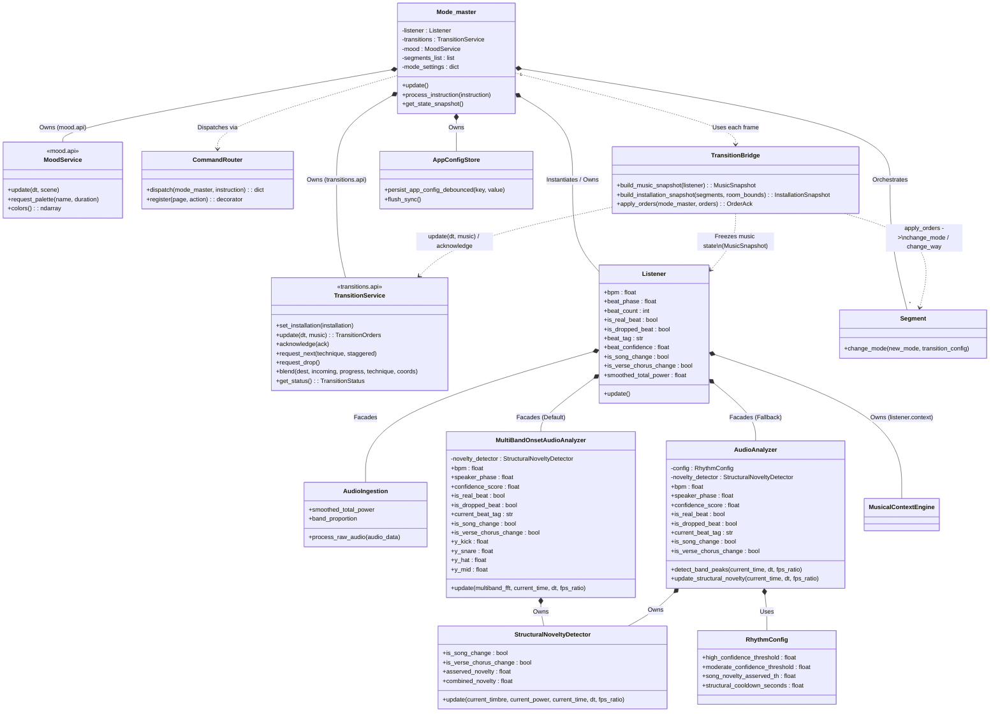

# Core Engine (`/core/`)

The `core` directory is the engine room of Vialactée. It contains the primary modules responsible for asynchronous orchestration, audio DSP processing, beat tracking, and structural event mapping.

## Key Components:

- **`CommandRouter.py`**: Modular instruction router. Extracts WebSocket action handling out of `Mode_master` using a clean decorator-based dispatch table (`@router.register(page, action)`) across `live_deck`, `topology`, `mode_settings`, and `system`.
- **`AppConfigStore.py`**: Persistence for `config/app_config.json`. Applies key/value updates through a debounced atomic write (temp file + `os.replace`) offloaded to background threads via `loop.run_in_executor()` to prevent frame stalls in the 30 FPS render loop.
- **`AudioIngestion.py`**: Dual-resolution leaf DSP filterbank engine. Receives raw PCM audio, initializes persisted luminosity/sensibility from `config/app_config.json`, and applies pure `numpy` vectorization to compute FFTs, 8 Mel bands for visual modes (`fft_band_values`), 32 Mel bands for multi-band rhythm analysis (`multiband_fft_values`), Chromagrams (12 pitch classes), and ADSR envelopes with explicit zero-division guards.
- **`comb_kernels.py`**: Standalone C-compiled kernel module (`build_dense_phase_bank`). Generates dense triangular pulse template banks across continuous tempo classes with zero dependency on `research/`, ensuring $<0.3\text{ms}$ CPU execution on embedded Raspberry Pi hardware.
- **`BaseAudioAnalyzer.py`**: The universal abstract base class defining the contract for all rhythm, transient, structural, and semantic music analysis models. Standardizes 6 functional domains (`execution`, `rhythm/metronome`, `spectral`, `macro-structure`, `semantics`, and `AI telemetry`) allowing drop-in substitution of experimental algorithms against the fixed benchmark harness.
- **`MultiBandOnsetAudioAnalyzer.py`**: Primary production implementation of `BaseAudioAnalyzer`. Employs a 32-band triangular Mel filterbank with half-wave rectified onset derivatives $\Delta E_b[t] = \max(0, E_b[t] - E_b[t-1])$ decomposed into 4 instrument separation streams: Kick ($y_{\text{kick}}$), Snare ($y_{\text{snare}}$), Hi-hat ($y_{\text{hat}}$), and Melodic Mid ($y_{\text{mid}}$) with non-linear squelch. Features kick-conditioned anti-phase disambiguation ($K_{\text{anti}} > 1.25 \cdot K_1$) that completely eliminates 180° upbeat traps on high-energy tracks (*Nightcall*), driving a continuous freewheeling speaker-time flywheel via standalone compiled `comb_kernels.py`.
- **`AudioAnalyzer.py`**: Legacy baseline implementation of `BaseAudioAnalyzer`. Single-ODF Anticipation Flywheel ("Oracle") engine with an $O(1)$ Pearson template bank, logarithmic tempo-class arithmetic, look-ahead phase back-projection to speaker time, refractory period lockout ($T_{\min} \approx 180\text{ms}$), backward soft-snap wrap clamp, real/dropped beat validation, and frequency-band tagging. Preserved for backwards compatibility and ablation benchmarks.
- **`StructuralNoveltyDetector.py`**: Dedicated structural novelty engine. Autonomously identifies Verse/Chorus boundaries, Seamless Crossfades, and Silence Drops using Short-Term Memory (STM) vs Long-Term Memory (LTM) tension wrapped in dynamic asserved mathematical envelopes.
- **`RhythmConfig.py`**: Centralized, strongly-typed configuration dataclass holding all thresholds, cooldowns, and constants for beat tracking, flywheel trust levels, and structural novelty detection.
- **`Listener.py`**: The transparent facade orchestrator. Dynamically instantiates the rhythm analyzer configured via `"analyzer_model"` in `config/app_config.json` (defaults to `DyadicMetricalAudioAnalyzer`; `MultiBandOnsetAudioAnalyzer` and `AudioAnalyzer` are selectable, and unknown names log a warning and use the default) and provides a fully backward-compatible API (`beat_phase`, `beat_count`, `bpm`, `is_real_beat`, `is_dropped_beat`, `beat_tag`, `beat_confidence`, `is_song_change`, `is_verse_chorus_change`) to feed data into visual modes and, via `TransitionBridge`, the transition sector. Manages a zero-allocation, pre-allocated 2D/1D NumPy circular ring buffer to synchronize real-time spectral arrays with the predictive lookahead of the beat tracker.
- **`MusicalContextEngine.py`**: Unified 3-tier musical context (`listener.context`). Continuous kinetics (`energy`, `tension`, `drop_progress`...), 4 macro scenes (`CHILL`, `GROOVE`, `BUILDUP`, `DROP_IMPACT`, plain `MusicalScene` enum with `scene`, `previous_scene`, `scene_blend`) with hysteresis and dwell locks, and micro badges (`is_locked`, `is_real_beat`, `is_drop_impact`, `is_structural_cut`...). See `docs/architecture/musical_context_engine.md`.
- **`Mode_master.py`**: The 30FPS rendering engine. Polls the `Listener` for audio features, resolves the active hardware profile (`"full"` vs `"small"`), builds the `Segment`s, starts every run with random modes and directions (`initiate_modes`), feeds the `transitions/` and `mood/` sectors through `TransitionBridge`, dispatches WebSocket instructions to `CommandRouter`, and exposes JSON-safe state snapshots for the web app. See `core/precisions/mode_master.md`.
- **`TransitionBridge.py`**: The only glue between the project (`Listener`, `Segment`, `Mode_master`) and the sealed `transitions/` package (and the palette request path to `mood/`): builds the music and installation snapshots and applies the sector's orders to the real segments. The transition logic itself (director clock, manager decisions, stagger patterns, blend engine) lives in `transitions/`; see `docs/reference/transition_contract.md`.
- **`Segment.py`**: A logical abstraction of the physical LED strips, mapping mathematical vectors to physical addresses using the resolved segment configuration. Features zero-allocation pre-allocated output buffers (`_scaled_buffer`), cached index reversal, and dual-buffer rendering via `Mode.render(buffer)`.
- **`Webapp_instruction_logger.py`**: Instruction logger sink instantiated by `connectors/Connector.py` to parse, format, and log incoming WebSocket commands from the web interface.

## How it works:

The `Mode_master` runs an asynchronous loop, asking the `Listener` for the current state of the music. Each frame it renders the LED `Segment`s using the algorithms defined in the `modes/` directory, then hands a frozen music snapshot (through `TransitionBridge`) to the sealed `transitions/` sector, which decides when and how modes change, and to the sealed `mood/` sector, which owns the colour palettes. When a `Connector` is attached, `Mode_master` also broadcasts changed state snapshots so Live Deck and Topology mirror automatic backend transitions.

## Core Architecture Diagram

The following diagram visualizes the interaction and structural relationship between `Listener`, `Mode_master`, the transition and mood sectors, `AudioAnalyzer`, and `StructuralNoveltyDetector`:

### Interaction within the Execution Loop (`update()`):

1. **Audio Ingestion & Calculation:**
   `Mode_master` fires `listener.update()` every frame. The `Listener` (acting as a facade) processes raw audio through `AudioIngestion`, updates `StructuralNoveltyDetector` for macro-structure, runs the predictive beat tracking pipeline in `MultiBandOnsetAudioAnalyzer` (or `AudioAnalyzer` if configured), and updates the `MusicalContextEngine` (`listener.context`: scene, kinetics, badges).
2. **Segment Rendering:**
   Each `Segment.update(status, blend, dt)` renders its active mode and, during a transition, mixes the dual buffers using the transition status and the sector's `blend` function.
3. **Music Snapshot & Palette:**
   `TransitionBridge.build_music_snapshot(listener)` freezes the music state for this frame. `mood.update(dt, scene)` lets the mood sector react to the scene (scene-driven palettes are off by default).
4. **Transition Decision:**
   `transitions.update(dt, music)` (the sealed `transitions/` sector) decides *whether, when and how* to transition (automatic timer, song or structure change, pre-drop buildup, drop impact, or a manual request). When it fires it returns `TransitionOrders`.
5. **Execution:**
   `TransitionBridge.apply_orders(mode_master, orders)` calls `Segment.change_mode(...)` / `change_way(...)` on the real segments and forwards any palette request to the mood sector. `transitions.acknowledge(...)` then reports which segments accepted.
