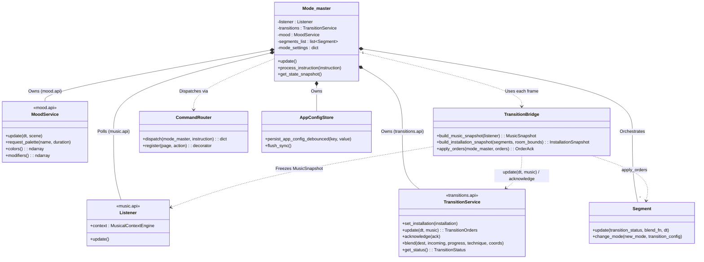

# Core Orchestrator (`/core/`)

The `core` directory is the central runtime orchestrator of Vialactée. It coordinates the 30 FPS LED rendering loop, manages physical `Segment` instances, bridges the sealed `music/`, `mood/`, and `transitions/` sectors, routes WebSocket instructions, and persists runtime configuration.

> **Sealed Sector Boundaries:**
> - **Music Analyzer & DSP (`music/`):** All audio ingestion, beat tracking, structural novelty detection, and 3-tier musical context live in [`music/`](../music/README.md) and are reached by production code exclusively through [`music/api.py`](../music/api.py) (see [`docs/contracts/music_analyzer_contract.md`](../docs/contracts/music_analyzer_contract.md)).
> - **Mood (`mood/`):** Curated palettes, scene debouncing, and cosine crossfades live in `mood/` and are reached only through [`mood/api.py`](../mood/api.py) (see [`docs/contracts/mood_contract.md`](../docs/contracts/mood_contract.md)).
> - **Transitions (`transitions/`):** Transition scheduling, stagger choreography, and dual-buffer blending live in `transitions/` and are reached only through [`transitions/api.py`](../transitions/api.py) (see [`docs/contracts/transition_contract.md`](../docs/contracts/transition_contract.md)).

## Key Components

- **`Mode_master.py`**: The 30 FPS rendering and orchestration engine. Polls `Listener` (`music.api`) for speaker-aligned audio features, resolves the active hardware profile (`"full"` vs `"small"`), instantiates physical `Segment`s, starts every run with random modes and directions (`initiate_modes`), feeds the `transitions/` and `mood/` sectors through `TransitionBridge`, dispatches WebSocket instructions to `CommandRouter`, and exposes JSON-safe state snapshots for the web app. See [`core/precisions/mode_master.md`](precisions/mode_master.md).
- **`Segment.py`**: Logical abstraction of a physical LED strip, mapping vectorized mode arrays to physical LED addresses using the resolved segment configuration. Features zero-allocation pre-allocated output buffers (`_scaled_buffer`), cached index reversal, and dual-buffer rendering via `Mode.render(buffer)`. See [`core/precisions/segment.md`](precisions/segment.md).
- **`TransitionBridge.py`**: The glue between the orchestrator (`Listener`, `Segment`, `Mode_master`) and the sealed `transitions/` and `mood/` sectors. Builds frozen `MusicSnapshot` and `InstallationSnapshot` payloads and applies `TransitionOrders` to the segments. See [`core/precisions/transition_director.md`](precisions/transition_director.md).
- **`CommandRouter.py`**: Modular instruction router. Dispatches WebSocket actions across `live_deck`, `topology`, `mode_settings`, and `system` using a decorator-based dispatch table (`@router.register(page, action)`).
- **`AppConfigStore.py`**: Persistence manager for `config/app_config.json`. Applies key/value updates through a debounced atomic write (temp file + `os.replace`) offloaded to background threads via `loop.run_in_executor()` to prevent frame stalls in the 30 FPS render loop.
- **`Webapp_instruction_logger.py`**: Instruction logger sink instantiated by `connectors/Connector.py` to parse, format, and log incoming WebSocket commands from the web interface.

## Architecture Diagram

## Per-Frame Execution Loop (`Mode_master.update()`)

1. **Audio Update:** `Mode_master` calls `listener.update()` (unless externally clocked by a local audio file stream), advancing the `music/` DSP pipeline and 5-second lookahead ring buffer.
2. **Hardware Flush:** Pushes the previous frame's RGB buffers to physical NeoPixels (via executor on Raspberry Pi) or the Pygame simulator (on the main thread).
3. **Segment Rendering:** Each `Segment.update(transition_status, blend, dt)` renders its active mode (and outgoing mode during dual-buffer transitions) into pre-allocated buffers.
4. **Music Snapshot, Mood & Transitions:** `TransitionBridge.build_music_snapshot(listener)` freezes the current speaker-aligned music state. `mood.update(dt, music.scene)` updates the live palette and scene modifier views in place. `transitions.update(dt, music)` evaluates whether to fire a transition and returns `TransitionOrders` when triggered.
5. **Connector Tick:** Broadcasts dirty state snapshots over WebSockets when attached.
