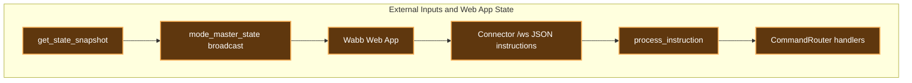

# Mode_master Internal Architecture

`Mode_master` is the central conductor of the installation. It owns the physical `Segment`s, runs the 30 FPS render loop, hands transition decisions to the sealed `transitions/` sector and palette decisions to the sealed `mood/` sector, routes web-app instructions to `CommandRouter`, and publishes JSON state snapshots for the web app.

It does **not** manage presets or playlists: on every start the installation begins from random segment modes and directions (`initiate_modes`), and everything after that is driven live by the music and by operator actions.

## 1. Flowchart & Architecture

### Initialization

```mermaid
graph TD
    classDef init fill:#2d3748,stroke:#4fd1c5,stroke-width:2px,color:#fff;

    subgraph init_phase [Initialization Phase]
        A["__init__"]:::init
        B["AppConfigStore(infos)<br/><i>app_config.json persistence</i>"]:::init
        C["compute_room_bounds(infos)"]:::init
        D["initiate_segments"]:::init
        E["_build_mode_settings_catalog"]:::init
        F["create_transition_service(infos)"]:::init
        G["create_mood_service + Mode.bind_mood_colors"]:::init
        H["initiate_modes<br/><i>random mode + direction per segment</i>"]:::init
        I["SystemStatus"]:::init

        A --> B --> C --> D --> E --> F --> G --> H --> I
    end
```

### Main Execution Loop

```mermaid
graph TD
    classDef loop fill:#1a365d,stroke:#63b3ed,stroke-width:2px,color:#fff;
    classDef sector fill:#276749,stroke:#68d391,stroke-width:2px,color:#fff;

    subgraph main_loop [update_forever, paced to the target FPS]
        L1["1. listener.update()<br/><i>skipped when externally clocked</i>"]:::loop
        L2["2. leds.show()<br/><i>flushes the previous frame</i>"]:::loop
        L3["3. segment.update(status, blend, dt) for every Segment"]:::loop
        L4["4. TransitionBridge.build_music_snapshot(listener)"]:::sector
        L5["5. mood.update(dt, scene)"]:::sector
        L6["6. transitions.update(dt, music) -> orders?"]:::sector
        L7["TransitionBridge.apply_orders + transitions.acknowledge"]:::sector
        L8["7. connector.on_frame_tick(self)<br/><i>broadcast snapshot if dirty</i>"]:::loop
        L9["8. profiler.tick()"]:::loop

        L1 --> L2 --> L3 --> L4 --> L5 --> L6
        L6 -->|orders| L7 --> L8
        L6 -->|none| L8
        L8 --> L9 --> L1
    end
```

### External Inputs

## 2. Internal Workflow Explained

### 1. Initialization (`__init__`)
*   **Hardware profile**: reads `hardware_profile` from `infos` (default `"full"`).
*   **`AppConfigStore`**: persists `config/app_config.json` (see section 3).
*   **`initiate_segments()`**: uses `resolve_segments_file_path(self.infos)` to read `config/segments_full.json` (or `segments_small.json`) and creates one `Segment` per physical strip (`v1`-`v4`, `h00`...`h32` for `full`, `s1`-`s3` for `small`). The segment layout and `config/modes.json` are parsed once per process and shared by all segments.
*   **Mode settings catalog**: `_build_mode_settings_catalog()` introspects the `Mode` instances held by the segments (see section 3).
*   **`create_transition_service(infos)`**: builds the transition front door. All timing and technique decisions live inside `transitions/`; see [`docs/reference/transition_contract.md`](../../docs/reference/transition_contract.md).
*   **`create_mood_service(...)`** and **`Mode.bind_mood_colors(...)`**: build the palette sector and give every mode a read-only view of the current palette; see [`docs/reference/mood_contract.md`](../../docs/reference/mood_contract.md).
*   **`initiate_modes()`**: picks a random available mode and a random direction (`UP`/`DOWN`) for every segment, initializes `self.mode_settings`, applies the effective mode settings, and pushes the installation description to the transition sector.

### 2. The Main Update Loop (`update()`)
Paced by `update_forever` (default target 30 FPS), the loop is strictly ordered:
1.  **Audio sync**: `listener.update()` fetches the latest FFT and rhythm state (skipped when the listener is clocked externally, e.g. by the local-file connector).
2.  **Hardware flush**: `leds.show()` flushes the **previous frame's** buffer to the strips to minimise latency (on a Raspberry Pi the blocking `show()` runs in an executor).
3.  **Segment execution**: every `Segment.update(transition_status, blend, dt=dt)` renders its active mode and, during a transition, mixes the dual buffers.
4.  **Music snapshot**: `TransitionBridge.build_music_snapshot(listener)` freezes what the sectors need to know about the music this frame.
5.  **Mood tick**: `mood.update(dt, music.scene)` (scene-driven palettes are off by default).
6.  **Transition tick**: `transitions.update(dt, music)` may return `TransitionOrders`. `TransitionBridge.apply_orders` executes them on the real segments (and forwards any palette request to the mood sector), then `transitions.acknowledge` reports which segments accepted.
7.  **Web state snapshot**: `connector.on_frame_tick(self)` broadcasts `get_state_snapshot()` when `_state_dirty` is set, and at most every 0.1 s while a transition runs. It costs nothing when no client is connected.

`Mode_master` never decides *when* or *how* to transition: it only obeys the orders the sector returns.

### 3. Mode settings and persistence
*   **Catalog**: `Mode_master` builds a catalog by introspecting each loaded `Mode`'s settings schema.
*   **Effective values** are merged in this order, later wins: catalog defaults, then the persisted `mode_settings` key of `app_config.json` (loaded into `infos`), then `self.mode_settings`. Every value is validated and clamped by `Mode.normalize_setting_value`.
*   **Live edit**: for `page: "mode_settings", action: "set_mode_setting"`, `CommandRouter` validates the request against the catalog with `Mode.normalize_setting_value`, updates `self.mode_settings`, re-applies the effective values to every segment instance of that mode, and persists them.
*   **Non-blocking persistence**: `_persist_app_config_value(key, value)` updates `infos` and calls `AppConfigStore.persist_app_config_debounced`, which serializes an immutable snapshot immediately, debounces for 0.5 s, then writes `app_config.json` atomically (temp file + `os.replace`) in `run_in_executor`, so slider changes never stall the render loop. `flush_sync()` writes any pending snapshot on shutdown. Mode settings are stored under the `mode_settings` key; luminosity, sensibility and the automatic transition interval use the same path.

### 4. External instructions & command routing
`Mode_master.process_instruction()` delegates to `CommandRouter` (`core/CommandRouter.py`), a decorator-based dispatch table (`@router.register(page, action)`):

| Page | Actions |
| :--- | :--- |
| `live_deck` | `set_luminosity`, `set_sensibility`, `set_auto_transition_time`, `select_mood`, `go_to_next_configuration` (asks the sector for the next transition), `manual_drop`, `lock_current_configuration`, `select_transition` (retired stub) |
| `topology` | `select_segment_mode` and `toggle_segment_direction` (act directly on the live `Segment`: `execute_mode_swap()` / `change_way()`) |
| `mode_settings` | `set_mode_setting` |
| `system` | `restart_python_loop`, `restart_raspberry_pi` |

A result with `applied: true` marks the state dirty so the next frame broadcasts a fresh snapshot.

### 5. State Snapshot Contract
`get_state_snapshot()` returns a JSON-safe view of:

* `hardwareProfile`: active profile string (`"full"` or `"small"`).
* `selectedTransition`: `"DYNAMIC"`.
* `transitionLocked`, `transitionState`, `transitionProgress`, `autoTransitionTime`: from `transitions.get_status()`.
* `luminosity`, `sensibility`: 0-100 integers from the listener.
* `availableModes`: sorted union of every mode name loaded by the segments.
* `activeMood`, `availableMoods`: from the mood service.
* `segments`: for each segment `id`, `name`, `mode`, `direction`, `blocked`, `targetMode`, `inTransition`.
* `modeSettingsCatalog`: every loaded mode that exposes settings.
* `modeSettings`: the effective values.
* `system`: runtime and hardware status from `SystemStatus`.

The snapshot is sent as a `mode_master_state` WebSocket message and is the authoritative source for the Live Deck telemetry, Topology map and Mode Settings page.
