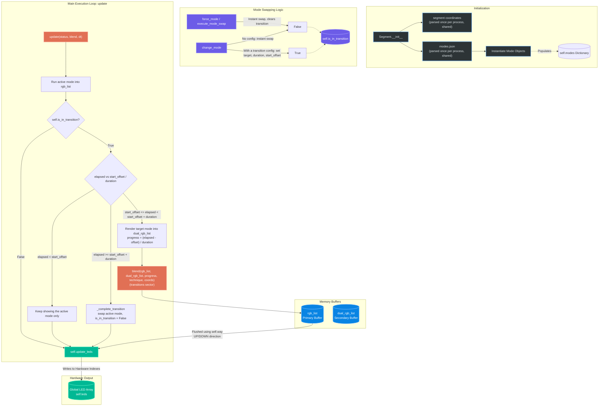

# Segment Internal Architecture

The `Segment` class is the bridge between the mathematical visual modes and the physical hardware LEDs. It is a local state machine that owns its buffers, instantiates the modes, runs its own transition timeline, and flushes the computed colors to the hardware.

Here is a visual breakdown of how it operates internally, followed by a detailed explanation of its core mechanisms.

## 1. Flowchart & Architecture

## 2. Internal Workflow Explained

### 1. Dynamic Initialization
On boot, the segment instantiates every allowed visual pattern (e.g. `Rainbow`, `Matrix Rain`) from the mode registry `config/modes.json` (vertical-only modes are added for vertical segments) and stores them in the `self.modes` dictionary for $O(1)$ instant lookup. The default mode is started immediately. `modes.json` and the segment coordinate layout are parsed **once per process** and shared by all segments (cached by file path and modification time), so creating 11 segments reads each file once.

### 2. Dual Buffering
The segment owns two $N \times 3$ NumPy matrices (`rgb_list` and `dual_rgb_list`).

### 3. State Machine
*   When `self.is_in_transition` is false, the active mode does its math and directly mutates `rgb_list`.
*   A transition is requested through `change_mode(mode, transition_config)` with `type`/`technique`, `duration` and an optional `start_offset` (used to ripple a change across the installation, see the staggering policy in `docs/reference/transition_contract.md`). `Mode_master` passes the frame time `dt`, and each segment keeps its **own** timeline (`transition_elapsed`):
    *   Before `start_offset` the segment keeps showing its active mode alone.
    *   Between `start_offset` and `start_offset + duration` the *old* mode keeps mutating `rgb_list` while the incoming mode is rendered into the secondary buffer via `target_mode.render(self.dual_rgb_list)`; this avoids manual pointer swapping and keeps memory isolated. `on_transition_exit` / `on_transition_enter` hooks receive the progress.
    *   At `start_offset + duration` (or immediately when the active mode declares `has_custom_transition`) `_complete_transition()` terminates the old mode, makes the target active, renders it into `rgb_list` for that frame and clears the transition state.
*   A legacy path without `dt` follows the transition sector's own status (`progress >= 1.0` or state `PASSATION`).
*   `execute_mode_swap()` and `force_mode()` abandon any pending transition (`_clear_transition`, which also terminates the incoming mode) and swap instantly through `_swap_active_mode`. They differ on purpose: `execute_mode_swap` validates the mode name **before** clearing the transition and restarts the mode even if it is already active, while `force_mode` clears first and does nothing if the mode is already active.

### 4. Blending
During the transition window, `blend(...)` (the transition service's in-place blend function, passed in by `Mode_master`) applies the technique (fade, wipes, gravity drop, explosion...) to mix `dual_rgb_list` into `rgb_list` at the segment's own progress, using the segment's 2D coordinates (reversed when the direction is `DOWN`). The technique comes from the segment's transition config, falling back to the status technique and finally `fade_in_out`.

### 5. Hardware Flush (Zero-Allocation Pipeline)
At the very end of the `update()` loop, `update_leds()` takes whatever is finalized in `rgb_list`, applies in-place luminosity scaling using pre-allocated buffer `_scaled_buffer` (`np.multiply(..., out=self._scaled_buffer, casting='unsafe')`), and flushes directly to the global hardware `self.leds` array (using pre-cached `_reversed_indexes` if `self.way == "DOWN"`). This zero-allocation path prevents Python garbage collection pauses during real-time 30/60 FPS rendering.
