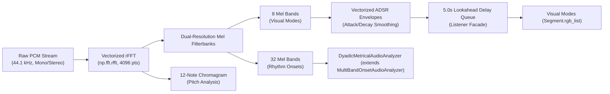

# Audio Pipeline & Feature Extraction Architecture

> **Location:** `docs/architecture/audio_pipeline.md` (Tier 1 Canonical Specification)  
> **Source Directory:** [`music/`](../../music/) (Front Door: [`music/api.py`](../../music/api.py), Contract: [`docs/contracts/music_analyzer_contract.md`](../contracts/music_analyzer_contract.md))  
> **Audio Connector:** [`connectors/Local_Microphone.py`](../../connectors/Local_Microphone.py)  
> **Enforcing Axioms:** [AXIOM-01](../axioms/AXIOM-01_FRAME_BUDGET.md), [AXIOM-02](../axioms/AXIOM-02_ZERO_ALLOCATION.md), [AXIOM-05](../axioms/AXIOM-05_LOOKAHEAD_SYNC.md), [AXIOM-09](../axioms/AXIOM-09_PLATFORM_AGNOSTIC_DSP.md)

---

## 1. Pipeline Overview

The audio pipeline transforms raw acoustic PCM stream data into mathematically structured, frequency-separated energy features for both visual animation modes and rhythm analysis.

---

## 2. Ingestion & Dual-Resolution Mel Filterbanks

Implemented in `music/AudioIngestion.py`:
1. **Windowing & FFT:**
   - Real FFT (`np.fft.rfft`) computed on 4096-sample audio frames (`buffer_size = 4096`, yielding 2049 frequency bins) with Hanning windowing.
   - Vectorized matrix multiplications map power spectrum bins into Mel frequency bins.
2. **Dual-Resolution Mel Filterbanks:**
   - **8 Bands (`fft_band_values`):** Preserved for visual lighting modes in `modes/` (Sub-bass, Bass, Low-Mid, Mid, High-Mid, Treble, Brilliance, Air).
   - **32 Bands (`multiband_fft_values`):** Fed into `DyadicMetricalAudioAnalyzer` (via its `MultiBandOnsetAudioAnalyzer` parent) to isolate fine-grained transients:
     - Sub-bass: 20–80 Hz
     - Kick fundamental: 60–120 Hz
     - Snare body and crack: 200–4000 Hz
     - Hi-hat shimmer: 8–16 kHz
3. **12-Tone Chromagram:**
   - Pre-computed pitch matrix maps spectral bins ($f > 30\text{ Hz}$) to the 12 chromatic semitones (C, C#, D, ..., B), smoothed with fast-attack/slow-release ADSR (`smoothed_chroma_values`).
   - Powers harmonic color calculation in `Synesthesia_mode` (where circular pitch-class vectors are blended with `mood_colors[0]` and `mood_accent` over a traveling spatial wave).

---

## 3. The 5.0-Second Lookahead Delay Queue

Implemented in `music/Listener.py`:
- Ingested audio is held in a 5.0-second FIFO circular queue.
- Rhythm tracking and novelty detection operate on the incoming live head of the audio ($T_{\text{ingest}}$).
- Visual animations receive the delayed audio features ($T_{\text{ingest}} - 5.0\text{ s}$), aligning visual animations with physical speaker output cone arrival time ($T_{\text{speaker}}$).
- Adheres strictly to **AXIOM-05 (Audio-Visual Latency Bound $< 50\text{ ms}$)**.

---

## 4. Sealed Sector Modules (`music/`)

`music/` is a sealed sector governed by [`docs/contracts/music_analyzer_contract.md`](../contracts/music_analyzer_contract.md) and enforced by `tests/governance/test_music_isolation.py`. Production code outside `music/` imports **only** from [`music.api`](../../music/api.py).

| Module | Role |
| :--- | :--- |
| [`music/api.py`](../../music/api.py) | **Front Door:** Re-exports `Listener`, `ANALYZER_REGISTRY`, `DEFAULT_ANALYZER_MODEL`, `resolve_analyzer_class`, `MusicalScene`, `MusicalContextEngine`, `ListenerProtocol`, and `MusicalContextProtocol`. |
| [`music/Listener.py`](../../music/Listener.py) | Lookahead delay ring buffer + speaker-time facade + `ANALYZER_REGISTRY`. |
| [`music/AudioIngestion.py`](../../music/AudioIngestion.py) | Vectorized 4096-pt rFFT, 8-band & 32-band Mel filterbanks, 12-bin chromagram, ADSR & GM/LM normalization. |
| [`music/BaseAudioAnalyzer.py`](../../music/BaseAudioAnalyzer.py) | Abstract base contract for all rhythm analyzers. |
| [`music/DyadicMetricalAudioAnalyzer.py`](../../music/DyadicMetricalAudioAnalyzer.py) | **Production default** (`DEFAULT_ANALYZER_MODEL`): dyadic metrical hierarchy + causal sub-pulse arbiter on top of the 32-band engine. |
| [`music/MultiBandOnsetAudioAnalyzer.py`](../../music/MultiBandOnsetAudioAnalyzer.py) | 32-band 4-stream onset engine (`kick`, `snare`, `hat`, `mid`) + Anticipation Flywheel (stable fallback / parent engine). |
| [`music/AudioAnalyzer.py`](../../music/AudioAnalyzer.py) | Legacy single-ODF baseline analyzer. |
| [`music/comb_kernels.py`](../../music/comb_kernels.py) | Compiled NumPy pulse-template bank for Pearson tempo correlation. |
| [`music/StructuralNoveltyDetector.py`](../../music/StructuralNoveltyDetector.py) | STM/LTM structural novelty, verse/chorus change, and song-cut detection. |
| [`music/MusicalContextEngine.py`](../../music/MusicalContextEngine.py) | 3-tier visual conductor synthesizing raw DSP into `MusicalContext` (`energy`, `tension`, `scene`, badges). |
| [`music/RhythmConfig.py`](../../music/RhythmConfig.py) | Centralized DSP and flywheel constants. |
