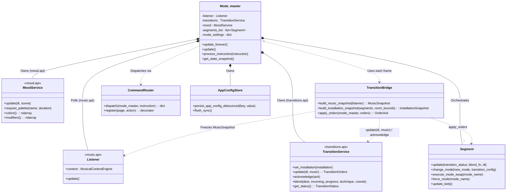
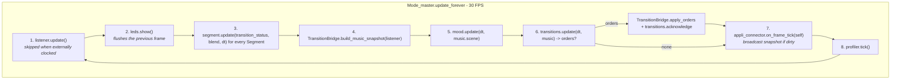

# Core Orchestrator Architecture (`core/`)

> **Location:** `docs/architecture/core_orchestrator.md` (Tier 1 Canonical Specification)  
> **Source Directory:** [`core/`](../../core/)  
> **Related Contracts:** [`docs/contracts/transition_contract.md`](../contracts/transition_contract.md), [`docs/contracts/mood_contract.md`](../contracts/mood_contract.md), [`docs/contracts/music_analyzer_contract.md`](../contracts/music_analyzer_contract.md), [`docs/contracts/mode_contract.md`](../contracts/mode_contract.md)  
> **Enforcing Axioms:** [AXIOM-01](../axioms/AXIOM-01_FRAME_BUDGET.md), [AXIOM-02](../axioms/AXIOM-02_ZERO_ALLOCATION.md), [AXIOM-03](../axioms/AXIOM-03_HARDWARE_GEOMETRY.md), [AXIOM-07](../axioms/AXIOM-07_CODE_GOVERNANCE.md)

The `core/` directory is the central runtime orchestrator of Vialactée. It coordinates the 30 FPS LED rendering loop, manages physical `Segment` instances, bridges the sealed `music/`, `mood/`, and `transitions/` sectors, routes WebSocket instructions, and persists runtime configuration.

---

## 1. Key Components & Class Relationships

| Module | Role & Responsibilities |
| :--- | :--- |
| [`core/Mode_master.py`](../../core/Mode_master.py) | The 30 FPS rendering and orchestration engine. Polls `Listener` (`music.api`) for speaker-aligned audio features, resolves the active hardware profile (`"full"` vs `"small"`), instantiates physical `Segment`s (`initiate_segments`), starts every run with random modes and directions (`initiate_modes`), feeds the `transitions/` and `mood/` sectors through `TransitionBridge`, dispatches WebSocket instructions to `CommandRouter`, and exposes JSON-safe state snapshots (`get_state_snapshot`) for the web app. |
| [`core/Segment.py`](../../core/Segment.py) | Logical abstraction of a physical LED strip, mapping vectorized mode arrays (`rgb_list`, `dual_rgb_list`) to physical LED addresses using the resolved segment configuration. Features zero-allocation pre-allocated output buffers (`_scaled_buffer`), cached index reversal (`_reversed_indexes`), and dual-buffer transition blending via `Mode.render(buffer)`. |
| [`core/TransitionBridge.py`](../../core/TransitionBridge.py) | Stateless boundary glue between the orchestrator (`Listener`, `Segment`, `Mode_master`) and the sealed `transitions/` and `mood/` sectors. Exposes `build_music_snapshot()`, `build_installation_snapshot()`, and `apply_orders()`. |
| [`core/CommandRouter.py`](../../core/CommandRouter.py) | Modular instruction router. Dispatches WebSocket actions across `live_deck`, `topology`, `mode_settings`, and `system` using a decorator-based dispatch table (`@router.register(page, action)`). |
| [`core/AppConfigStore.py`](../../core/AppConfigStore.py) | Persistence manager for `config/app_config.json`. Applies key/value updates through a debounced atomic write (temp file + `os.replace`) offloaded to background threads via `loop.run_in_executor()` to prevent frame stalls in the 30 FPS render loop. |
| [`core/Webapp_instruction_logger.py`](../../core/Webapp_instruction_logger.py) | Instruction logger sink instantiated by `connectors/Connector.py` to parse, format, and log incoming WebSocket commands from the web interface. |

---

## 2. `Mode_master` (`core/Mode_master.py`)

### 2.1 Initialization (`__init__`)
1. **Hardware profile & bounds:** Reads `hardware_profile` from `infos` (default `"full"`), initializes `AppConfigStore(infos)`, and computes room coordinate bounds via `compute_room_bounds(infos)`.
2. **`initiate_segments()`:** Uses `resolve_segments_file_path(self.infos)` to read `config/segments_full.json` (or `config/segments_small.json`) and creates one `Segment` per physical strip (`v1`–`v4`, `h00`, `h10`, `h11`, `h20`, `h30`, `h31`, `h32` for `full`; `s1`–`s3` for `small`). The segment layout and `config/modes.json` are parsed once per process and shared across segments.
3. **Mode settings catalog:** `_build_mode_settings_catalog()` introspects the `Mode` instances held by the segments.
4. **Sealed sector services:**
   - `self.transitions = create_transition_service(self.infos)` builds the transition front door (see [`docs/contracts/transition_contract.md`](../contracts/transition_contract.md)).
   - `self.mood = create_mood_service(auto_scene=True)` builds the palette and scene modifier service, and binds shared read-only views onto `Mode` via `Mode.bind_mood_colors(self.mood.colors())` and `Mode.bind_mood_modifiers(self.mood.modifiers())` (see [`docs/contracts/mood_contract.md`](../contracts/mood_contract.md)).
5. **`initiate_modes()`:** Picks a random available mode (`segment.change_mode(mode_name)`) and a random direction (`segment.change_way("UP" | "DOWN")`) for every segment, initializes `self.mode_settings`, applies effective mode settings (`_apply_active_mode_settings()`), and pushes the installation description to the transition sector (`_push_installation()`).
6. **`SystemStatus`:** Instantiates `connectors.System_status.SystemStatus` for host/runtime telemetry.

### 2.2 The Main Update Loop (`update_forever()` / `update()`)
Paced by `update_forever()` to the target framerate (default **30 FPS** per [AXIOM-01](../axioms/AXIOM-01_FRAME_BUDGET.md)), `Mode_master.update()` executes in strict order:

1. **Audio sync:** `listener.update()` fetches the latest FFT and rhythm state (skipped when `listener.is_externally_clocked` is true).
2. **Hardware flush:** `leds.show()` flushes the **previous frame's** buffer to the strips to minimize latency. On Raspberry Pi (`onRaspberry`, `HARDWARE_MODE == "rpi"`, or `_is_rpi_hardware`), blocking `show()` runs in `loop.run_in_executor(None, led_strip.show)`; on Windows Pygame simulation, `led_strip.show()` runs on the main thread.
3. **Segment execution:** Every `seg.update(transition_status, blend, dt=dt)` renders its active mode, blends `dual_rgb_list` into `rgb_list` during an active transition, and flushes to the strip buffer via `seg.update_leds()`.
4. **Music snapshot:** `TransitionBridge.build_music_snapshot(self.listener)` freezes what the sectors need to know about the music this frame.
5. **Mood tick:** `self.mood.update(dt, music.scene)` updates the bound `Mode._mood_colors` and `Mode._mood_modifiers` views in place.
6. **Transition tick:** `self.transitions.update(dt, music)` may return `TransitionOrders`. `TransitionBridge.apply_orders(self, orders)` executes them on the real segments (and forwards any `orders.palette` via `mood.request_palette`), then `self.transitions.acknowledge(...)` reports which segments accepted.
7. **Web state snapshot:** `appli_connector.on_frame_tick(self)` broadcasts `get_state_snapshot()` when `_state_dirty` is set, and at most every `0.1 s` while a transition runs. It costs `0.0 ms` when no client is connected.

### 2.3 Mode Settings, Command Routing & State Snapshot Contract
- **Effective settings:** Merged in order (later wins): catalog defaults (`_mode_settings_defaults_for_mode`), persisted `infos["mode_settings"]` from `config/app_config.json`, then runtime `self.mode_settings`. Validated and clamped by `Mode.normalize_setting_value`.
- **Non-blocking persistence:** `_persist_app_config_value(key, value)` updates `infos` and calls `AppConfigStore.persist_app_config_debounced(key, value)`, which debounces for `0.5 s` and writes `config/app_config.json` atomically (`temp file + os.replace`) inside `run_in_executor`. `flush_sync()` flushes pending writes on shutdown.
- **Command routing (`CommandRouter.py`):** `Mode_master.process_instruction(instruction)` delegates to `@router.register(page, action)`:

| Page | Actions |
| :--- | :--- |
| `live_deck` | `set_luminosity`, `set_sensibility`, `set_auto_transition_time`, `select_mood`, `go_to_next_configuration`, `manual_drop`, `lock_current_configuration`, `select_transition` (retired stub) |
| `topology` | `select_segment_mode`, `toggle_segment_direction` (`Segment.execute_mode_swap()` / `Segment.change_way()`) |
| `mode_settings` | `set_mode_setting` |
| `system` | `restart_python_loop`, `restart_raspberry_pi` |

- **State snapshot (`get_state_snapshot()`):** Returns `hardwareProfile`, `selectedTransition` (`"DYNAMIC"`), `transitionLocked`, `transitionState`, `transitionProgress`, `luminosity`, `sensibility`, `autoTransitionTime`, `availableModes`, `activeMood`, `availableMoods`, `segments` (`id`, `name`, `mode`, `direction`, `blocked`, `targetMode`, `inTransition`), `modeSettingsCatalog`, `modeSettings`, and `system`. Broadcast by `Connector` as `{"type": "mode_master_state", "payload": state}`.

---

## 3. `TransitionBridge` (`core/TransitionBridge.py`)

`TransitionBridge` is a stateless adapter module containing the only three functions outside `transitions/` that translate between project objects and `transitions.api` (see [`docs/contracts/transition_contract.md`](../contracts/transition_contract.md)):

1. **`build_music_snapshot(listener) -> MusicSnapshot`:** Reads speaker-aligned rhythm/energy properties and `listener.context` (plus `live_is_song_change`, `live_is_verse_chorus_change`, and `lookahead_seconds`) into a frozen `MusicSnapshot`.
2. **`build_installation_snapshot(segments, room_bounds) -> InstallationSnapshot`:** Describes each `Segment` as a `SegmentDescriptor(name, orientation, available_modes, active_mode, is_blocked)` along with `room_bounds`.
3. **`apply_orders(mode_master, orders) -> OrderAck`:**
   - For each `SegmentOrder` in `orders.orders`, looks up the segment via `mode_master._find_segment_by_name(order.segment)`.
   - Blocked or missing segments are appended to `refused`.
   - Otherwise builds `cfg = {"type": order.technique, "duration": order.duration, "mode_handshake": bool(order.mode_handshake)}` (plus `"start_offset"` if non-zero, and `"force": True` when `orders.reason in ("drop_impact", "request_drop")`), calls `segment.change_mode(order.target_mode, cfg)` and `segment.change_way(order.direction)`, and records the segment in `accepted` if `segment.is_in_transition` is true (else `refused`).
   - If `orders.palette` is present, calls `mode_master.mood.request_palette(orders.palette.palette, orders.palette.duration)`.

---

## 4. `Segment` (`core/Segment.py`)

Each `Segment` is a local state machine that owns its pixel buffers, instantiates its modes from `config/modes.json` (cached once per process in `Segment._MODES_CONFIG_CACHE`), runs its own transition timeline, and flushes computed colors to the hardware channel array.

### 4.1 Pre-Allocated Memory Buffers (AXIOM-02)
- `self.rgb_list`: shape `(nb_of_leds, 3)`, `dtype=np.int32` — primary render buffer mutated by the active mode (`self.activ_mode`).
- `self.dual_rgb_list`: shape `(nb_of_leds, 3)`, `dtype=np.int32` — secondary render buffer mutated by the incoming mode (`self.target_mode_name`) during a transition.
- `self._scaled_buffer`: shape `(nb_of_leds, 3)`, `dtype=np.int32` — scratch buffer used in `update_leds()` for in-place luminosity scaling (`np.multiply(self.rgb_list, self.listener.luminosite, out=self._scaled_buffer, casting='unsafe')`).
- `self.coords_array` and `self._reversed_coords_array`: pre-loaded 2D spatial coordinate arrays `(nb_of_leds, 2)` for spatial transitions.

### 4.2 Transition State Machine & Mode Swapping
- **Steady state (`self.is_in_transition == False`):** `Segment.update(status, blend, dt)` updates `self.modes[self.activ_mode]` into `self.rgb_list` and flushes via `self.update_leds()`.
- **Requesting a transition (`change_mode(mode_name, transition_config)`):**
  - Ignored if `self.isBlocked` is `True`.
  - If `transition_config is None`, performs an instant swap via `execute_mode_swap(mode_name)`.
  - With a `transition_config` (`type`/`technique`, `duration`, `start_offset`, `force`), pre-starts `self.modes[self.target_mode_name]` and sets `self.is_in_transition = True` with `self.transition_elapsed = 0.0`.
- **Per-frame transition timeline (`self.is_in_transition == True`):**
  - Advances `self.transition_elapsed += dt`.
  - **Before `start_offset` (`transition_elapsed < start_offset`):** Keeps showing `self.activ_mode` alone.
  - **Active window (`start_offset <= transition_elapsed < start_offset + duration`):** Computes `prog = (transition_elapsed - start_offset) / duration`, invokes `target_mode.on_transition_enter(prog)` and `activ_mode_obj.on_transition_exit(prog)`, renders the incoming mode into `self.dual_rgb_list` via `target_mode.render(self.dual_rgb_list)`, and calls `blend(self.rgb_list, self.dual_rgb_list, prog, tech, active_coords)` to mix `dual_rgb_list` into `rgb_list` in place.
  - **Completion (`transition_elapsed >= start_offset + duration` or `has_custom_transition`):** `_complete_transition()` terminates the old mode, promotes `self.activ_mode = self.target_mode_name`, clears transition flags, renders the new active mode into `self.rgb_list`, and flushes.
- **Instant swap helpers:** `execute_mode_swap(mode_name)` validates the mode name before clearing any active transition and restarts the mode even if already active; `force_mode(mode_name)` clears any pending transition first and is a no-op if `mode_name == self.activ_mode`.

### 4.3 Hardware Flush & Direction (`update_leds()`)
At the end of `Segment.update()`, `update_leds()` scales `self.rgb_list` by `self.listener.luminosite` into `self._scaled_buffer` in place and writes directly into the channel hardware array:
- When `self.way == "UP"`: writes in forward hardware index order (`self.leds[self.indexes] = self._scaled_buffer`).
- When `self.way == "DOWN"`: writes using the pre-cached reversed index list (`self.leds[self._reversed_indexes] = self._scaled_buffer`).
