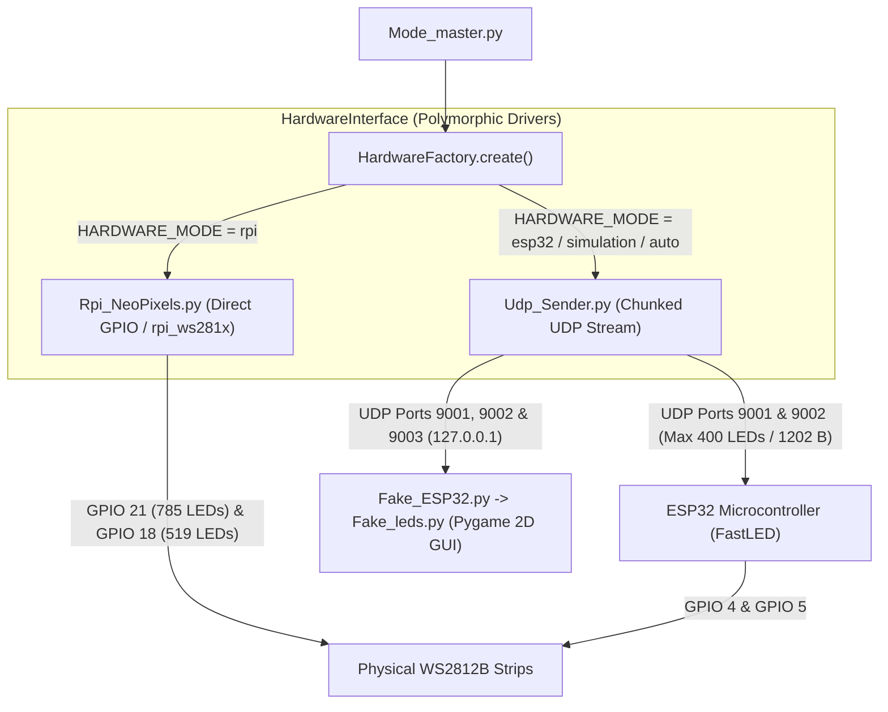

# Hardware Abstraction Layer (HAL) & Topologies

> **Location:** `docs/architecture/hardware_abstraction.md` (Tier 1 Canonical Specification)  
> **Source Directory:** [`hardware/`](../../hardware/)  
> **Enforcing Axioms:** [AXIOM-03: Physical Chandelier Geometry](../axioms/AXIOM-03_HARDWARE_GEOMETRY.md), [AXIOM-04: Network Protocols](../axioms/AXIOM-04_NETWORK_PROTOCOLS.md), [AXIOM-09: Scoped DSP Math Invariance](../axioms/AXIOM-09_PLATFORM_AGNOSTIC_DSP.md)

---

## 1. Hardware Module Inventory (`hardware/`)

| File / Directory | Role |
| :--- | :--- |
| [`hardware/HardwareInterface.py`](../../hardware/HardwareInterface.py) | Abstract base interface implemented by all LED output drivers (`__getitem__`, `__setitem__`, `__len__`, `set_pixel()`, `clear()`, `show()`, `close()`). |
| [`hardware/HardwareFactory.py`](../../hardware/HardwareFactory.py) | Inspects `HARDWARE_MODE`, `hardware_profile`, and host OS to instantiate one `HardwareInterface` per LED channel and optionally spawn the local `Fake_ESP32.py` simulator subprocess. |
| [`hardware/Udp_Sender.py`](../../hardware/Udp_Sender.py) | Streams chunked binary RGB frames over UDP (`9001`/`9002`) to a physical ESP32 or local `Fake_ESP32`, plus throttled JSON sideband telemetry (`9003`) and control polling (`9004`). |
| [`hardware/Rpi_NeoPixels.py`](../../hardware/Rpi_NeoPixels.py) | Direct Raspberry Pi GPIO DMA WS2812B driver wrapping `adafruit_neopixel` / `rpi_ws281x` (`board.D21`, `board.D18`). |
| [`hardware/Fake_ESP32.py`](../../hardware/Fake_ESP32.py) | Local UDP receiver process that drains pixel datagrams on ports `9001`/`9002` and metadata datagrams on port `9003`, rendering into `FakeLedsVisualizer`. |
| [`hardware/Fake_leds.py`](../../hardware/Fake_leds.py) | Interactive Pygame desktop visualizer reconstructing chandelier geometry from `config/segments_*.json` and rendering the optional live DSP HUD (`show_music_analyser_panel`). |
| [`hardware/esp32_firmware/`](../../hardware/esp32_firmware/) | C++/Arduino FastLED sketches for physical ESP32 microcontrollers (see [`docs/manuals/raspberry_pi_deployment.md`](../manuals/raspberry_pi_deployment.md)). |

---

## 2. Driver Selection Matrix (`HardwareFactory.py`)

| `HARDWARE_MODE` | Windows Behavior | Raspberry Pi Behavior | Output Driver |
| :--- | :--- | :--- | :--- |
| `"auto"` (Default) | Spawns local `Fake_ESP32.py` + Pygame visualizer | Streams UDP packets to `esp32_ip` | `Udp_Sender` |
| `"simulation"` | Spawns local `Fake_ESP32.py` + Pygame visualizer | Spawns local `Fake_ESP32.py` + X11 Pygame | `Udp_Sender` (`127.0.0.1`) |
| `"esp32"` | Streams UDP packets to `esp32_ip` | Streams UDP packets to `esp32_ip` | `Udp_Sender` (`esp32_ip`) |
| `"rpi"` | Falls back to `"simulation"` with warning | Direct GPIO DMA via `rpi_ws281x` | `Rpi_NeoPixels` |

---

## 3. UDP Port Architecture (`9001`–`9004`)

`Udp_Sender.py` and `Fake_ESP32.py` communicate over four local/network UDP ports:

| Port | Constant | Direction | Payload Format & Cadence |
| :---: | :--- | :--- | :--- |
| `9001` | `PORT_STRIP_1` | `Udp_Sender -> ESP32 / Fake_ESP32` | Binary pixel chunks (`<H` uint16 LE `start_index` + RGB bytes, $\le 400$ LEDs / $1,202\text{ B}$ per packet) for Channel 1 at 30 FPS. |
| `9002` | `PORT_STRIP_2` | `Udp_Sender -> ESP32 / Fake_ESP32` | Binary pixel chunks for Channel 2 at 30 FPS (`full` profile only). |
| `9003` | `SEGMENT_METADATA_PORT` | `Udp_Sender -> Fake_ESP32` | UTF-8 JSON sideband telemetry for the simulator HUD: `{"type": "segment_mode", ...}` (on transition or 1 Hz heartbeat), `{"type": "analyzer_state", ...}` (10 Hz throttle), and `{"type": "transition_state", ...}` (on change or 10 Hz throttle). Ignored by physical ESP32 hardware. |
| `9004` | `CONTROL_PORT` | `Fake_leds UI -> Udp_Sender` | UTF-8 JSON control socket bound on `127.0.0.1:9004` allowing the Pygame simulator toolbar to trigger transitions (`{"type": "request_transition", "technique": ..., "duration": ...}`). |

---

## 4. Physical Topologies (`full` vs `small`)

### A. Full Profile (`config/segments_full.json`)
- **Total LEDs:** **1,304** across **11 segments** on **2 channels**.
- **Channel 1 (`segs_1`, Port `9001`, GPIO `D21` on Pi / `GPIO 4` on ESP32, 785 LEDs):**
  - `Segment v4` (`v4`, 173 LEDs, vertical)
  - `Segment h32` (`h32`, 48 LEDs, horizontal)
  - `Segment h31` (`h31`, 48 LEDs, horizontal)
  - `Segment h30` (`h30`, 47 LEDs, horizontal)
  - `Segment v3` (`v3`, 173 LEDs, vertical)
  - `Segment h20` (`h20`, 91 LEDs, horizontal)
  - `Segment h00` (`h00`, 205 LEDs, horizontal)
- **Channel 2 (`segs_2`, Port `9002`, GPIO `D18` on Pi / `GPIO 5` on ESP32, 519 LEDs):**
  - `Segment v2` (`v2`, 173 LEDs, vertical)
  - `Segment h11` (`h11`, 87 LEDs, horizontal)
  - `Segment h10` (`h10`, 86 LEDs, horizontal)
  - `Segment v1` (`v1`, 173 LEDs, vertical)

### B. Small Profile (`config/segments_small.json`)
- **Total LEDs:** **249** across **3 segments** on **1 channel**.
- **Channel 1 (`segs_1`, Port `9001`, GPIO `D21` on Pi / `GPIO 4` on ESP32, 249 LEDs):**
  - `Segment s1` (`s1`, 49 LEDs, vertical)
  - `Segment s2` (`s2`, 108 LEDs, vertical)
  - `Segment s3` (`s3`, 92 LEDs, vertical)

---

## 5. The Vertical Orientation Invariant (AXIOM-03)

All vertical chandelier segments (`v1`, `v2`, `v3`, `v4`, and `s1`–`s3`) are physically wired **from bottom to top**:
- Index `0` is at the bottom-most physical point (`start.y` is maximum Y).
- Index `N - 1` is at the top-most ceiling attachment (`step.y = -1`).
- In `Fake_leds.py`, vertical strips render upward (`y -= 2` per pixel).
