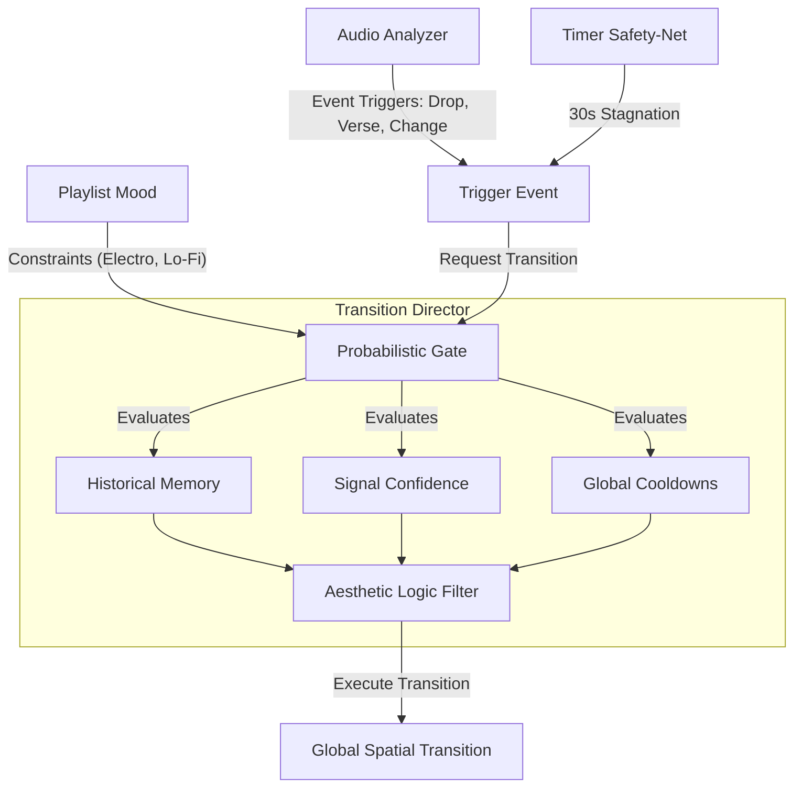

# Prospective Transitions Concepts & Research Archive

> [!WARNING]
> **TIER 4 ARCHIVE DOCUMENT**: This document captures exploratory concepts, mathematical ideas, and prospective routines. It is **NOT** a canonical specification and must **NOT** be cited as production truth.

---

## 1. The Stateful Probabilistic Gate & Aesthetic Logic Filter

The prospective decision model envisions an autonomous probabilistic engine governing when and how transitions trigger, moving beyond fixed timers:

### Planned Triggering Mechanisms:
1. **Audio Event Triggering:**
   - Automatic triggers on detected Verse/Chorus boundaries, structural drops, and song cuts from `StructuralNoveltyDetector` and `AudioAnalyzer`.
   - Delayed triggers synchronized with physical speaker playback.
2. **The Probabilistic Gate Factors:**
   - **Historical Memory:** Prevent repetitive selection (e.g. "I just performed an explosion transition 15 seconds ago, so reduce its probability to ~0%").
   - **Signal Confidence Weighting:** Scale transition aggressiveness based on analyzer confidence (e.g., massive 99% confident chorus drop triggers high-velocity spatial explosions; low-confidence shifts trigger gentle dual fades).
   - **Global Cooldowns:** Enforce minimum spacing between automatic transitions to prevent chaotic visual strobing.
3. **Playlist-Level Constraints:**
   - "Electro / Peak-Time" playlists restrict available transitions to fast, high-contrast effects (explosions, glitch, rapid wipes).
   - "Lo-Fi / Ambient" playlists restrict transitions to slow crossfades and dual fades.

---

## 2. Prospective Spatial Transition Algorithms

The following mathematical routines are conceptual targets for `Transition_Engine.py`:

1. **Audio-Spatial Gravity Cannon:**
   - An invisible ray shoots upward from the floor on massive bass transients (`band_flux[0]`), punching holes in the Old Mode. Displaced pixels fall via a simulated gravitational field ($y \leftarrow y + \frac{1}{2} g t^2$), revealing the New Mode beneath.
2. **Venetian Blinds (Interlaced Geometry):**
   - The Y-axis is sliced into horizontal bands (e.g., 10-pixel slices). Even bands render the New Mode, odd bands render the Old Mode. The New Mode bands expand vertically until the chandelier is saturated.
3. **Black Hole Collapse (Singularity Shockwave):**
   - Pixels of the Old Mode accelerate inward toward a central pivot $(X_c, Y_c)$, compressing into a dense singularity point.

---

## 3. Next-Session Design Ideas (Perceptual Weight, Partial Scope & Bespoke Mode Transitions)

*Recorded: October 15, 2026*

### 3.1 Perceptual Weight & Duration of Global Transitions ("Showstoppers")
- **Problem:** When a full-chandelier transition is too short, the viewer does not have enough time to consciously register that a transition is happening, which strips the transition of its dramatic importance.
- **Design Direction:** Global transitions with a clear beginning, build-up, and climax (such as `explosion`) must be given enough duration and breathing room so the audience perceives them as intentional architectural events.

### 3.2 Negligible / Subtle Micro-Transitions on 1–2 Segments Only
- **Concept:** Not every transition should be a full-installation event across all 10 segments. Small, subtle, "almost negligible" transitions are still valuable, **provided they only mutate 1 or 2 segments at a time** rather than the entire chandelier.
- **Architectural Implication:** Currently, [`Transition_Director`](file:///c:/Users/Users/Desktop/vialactée/vialactee/transitions/manager.py) retargets all non-blocked segments on every transition (§5 Invariant in [`transition_contract.md`](file:///c:/Users/Users/Desktop/vialactée/vialactee/docs/reference/transition_contract.md)). A future **Two-Tier Scope Policy** would distinguish:
  1. **Macro / Global Transitions:** Full-chandelier choreographies with noticeable duration and clear narrative arc (`explosion`, `gravity_drop`, `spiral`, etc.) triggered on major musical boundaries.
  2. **Micro / Partial Transitions:** Short, understated transitions (`global_change`, `silk_wipe`, `ember_dissolve`) that retarget only **1 or 2 segments**, allowing the chandelier to organically drift and evolve piece-by-piece between major musical sections.

### 3.3 Personal / Bespoke Mode-Specific Complex Transitions
- **Concept:** Beyond shared shaders in `transitions/` and the scalar `transition_scale` handshake, individual modes should be able to define **highly complex, multi-phase personal transitions** using their own internal physics and state machines.
- **Example (`Extending_waves_mode` White Accumulation Finale):**
  - When `Extending_waves_mode` is exiting (or entering), white waves spawn and travel toward the middle/end of the strip.
  - Instead of vanishing at the boundary as usual, each arriving white wave **sticks and accumulates**, filling up the strip bit by bit until the entire segment is completely saturated in solid white—before releasing into the next mode.
- **Architectural Implication:** Allow a mode class to optionally declare a custom multi-phase exit/enter routine (or take full control of the pixel buffer during its exit phase) before handing off to the incoming mode.

