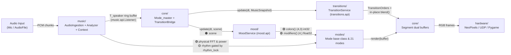

# Entity Architecture & Trust-Rated Contracts

This directory is the **single source of truth** for the sealed sector contracts and inter-sector signal trust ratings of the Vialactée interactive LED chandelier.

---

## 1. Sealed Entity Map

| Entity / Sector | Package | Front Door (`api.py`) | Canonical Contract | Governance Test |
| :--- | :--- | :--- | :--- | :--- |
| **Music Analyzer & DSP** | [`music/`](../../music/) | [`music/api.py`](../../music/api.py) | [`music_analyzer_contract.md`](music_analyzer_contract.md) | [`tests/governance/test_music_isolation.py`](../../tests/governance/test_music_isolation.py) & [`tests/governance/test_docs_parity.py`](../../tests/governance/test_docs_parity.py) |
| **Mood & Palettes** | [`mood/`](../../mood/) | [`mood/api.py`](../../mood/api.py) | [`mood_contract.md`](mood_contract.md) | [`tests/governance/test_mood_isolation.py`](../../tests/governance/test_mood_isolation.py) |
| **Transitions & Choreography** | [`transitions/`](../../transitions/) | [`transitions/api.py`](../../transitions/api.py) | [`transition_contract.md`](transition_contract.md) | [`tests/governance/test_transition_isolation.py`](../../tests/governance/test_transition_isolation.py) |
| **Visual Modes** | [`modes/`](../../modes/) | [`modes/Mode.py`](../../modes/Mode.py) | [`modes/MODE_RULES.md`](../../modes/MODE_RULES.md) (Part A) | [`tests/governance/test_docs_parity.py`](../../tests/governance/test_docs_parity.py) (`test_modes_respect_trust_tiers`) |
| **Core Orchestrator** | [`core/`](../../core/) | `Mode_master`, `Segment`, `TransitionBridge`, `CommandRouter`, `AppConfigStore` | [`core/README.md`](../../core/README.md) | [`tests/governance/test_axiom_07_code_governance.py`](../../tests/governance/test_axiom_07_code_governance.py) |
| **Hardware & Simulators** | [`hardware/`](../../hardware/) | `HardwareFactory.create_hardware(infos)` | [`docs/reference/coordinates_matrix.md`](../reference/coordinates_matrix.md) & [`docs/manuals/raspberry_pi_deployment.md`](../manuals/raspberry_pi_deployment.md) | [`tests/governance/test_axiom_03_geometry.py`](../../tests/governance/test_axiom_03_geometry.py) |
| **Async Connectors & Web UI** | [`connectors/`](../../connectors/) | `Connector`, `Local_Microphone`, `Local_AudioFile` | [`docs/architecture/api_and_wire_protocol.md`](../architecture/api_and_wire_protocol.md) | [`tests/governance/test_axiom_04_network_limits.py`](../../tests/governance/test_axiom_04_network_limits.py) |

---

## 2. One-Frame Dataflow (30 FPS Render Loop, 60 Hz DSP Clock)

1. **Audio Ingestion & Lookahead Alignment (`music/`):** Raw PCM audio enters `Listener.process_raw_audio()`. `Listener.update()` advances the 5-second lookahead rhythm analyzer (`DyadicMetricalAudioAnalyzer` by default), writes spectral/novelty/rhythm frames into a zero-allocation circular ring buffer, pops speaker-aligned (`T_speaker`) features, and updates `listener.context` (`MusicalContextEngine`).
2. **Hardware Show (`hardware/`):** `Mode_master.update()` flushes the previous frame's RGB buffers to physical LEDs or the simulator.
3. **Mode Rendering (`modes/` & `core/Segment.py`):** Each `Segment` renders its active mode (and outgoing mode during `TRANSITION_DUAL`) into pre-allocated buffers and blends them in place via `TransitionService.blend()`.
4. **Mood Shock Absorber (`mood/`):** `TransitionBridge.build_music_snapshot(listener)` freezes the current frame's music state. `mood.update(dt, music.scene)` debounces (`0.30 s`) and cosine-crossfades (`2.5 s`) the 🟠 `scene` heuristic into 🟢 `mood.modifiers()` (`[pace, sharpness, trail, accent_mix]`) and (`4.0 s` dwell, `3.0 s` crossfade) `mood.colors()`.
5. **Transition Scheduling (`transitions/`):** `transitions.update(dt, music)` advances cooldowns and lookahead countdowns, returning `TransitionOrders` on the frame a transition fires.

---

## 3. Signal Trust Tiers

Not all signals leaving `music/` have the same reliability. Every signal crossing a sector boundary is assigned one of three trust ratings (plus a static/runtime `CONFIG` classification for non-signal settings):

| Tier | Meaning | Consumer Rule | Canonical Examples |
| :--- | :--- | :--- | :--- |
| **🟢 HIGH** *(physical / pre-gated)* | Direct spectral measurement from the FFT filterbank, or a signal already debounced and cosine-smoothed inside its own sealed room | Safe to drive brightness, spatial extent, or colour directly every frame without extra gating | `asserved_fft_band`, `asserved_total_power`, `band_flux`, `spectral_tilt`, `energy`, `mood_colors` and `mood_modifiers` *(as consumed)* |
| **🟡 MEDIUM** *(confidence-gated)* | Tempo/phase flywheel estimate or rhythm badge that can drift on beatless intros, breakdowns, or complex polyrhythms | **Never use raw in modes.** Always gate or blend by `rhythm_lock` (`beat_trust`, `rhythm_salience`, `is_locked`, `beat_confidence`, or `Mode.beat_pulse()`), with a continuous fallback when confidence is `0.0` | `bpm`, `beat_phase`, `beat_count`, `is_beat`, `is_real_beat`, `is_dropped_beat`, `beat_tag`, `rhythm_salience`, `beat_trust` |
| **🟠 LOW** *(heuristic / predictive)* | Macro scene classification, structural novelty envelope, or lookahead boundary prediction prone to false positives and jitter | **Never read directly in concrete modes** (`modes/*_mode.py`) and never use for hard branches, velocity flips, or 1.5 s whiteouts. Must be absorbed behind debounce/dwell (`mood/`), security cooldowns (`transitions/`), or sanctioned `Mode.py` envelope helpers (`self.drop_hit`, `self.drop_decay`) | `scene`, `drop_countdown`, `drop_progress`, `is_drop_imminent`, `is_drop_impact`, `is_song_change`, `is_verse_chorus_change`, `is_structural_cut` |
| **⚙️ CONFIG** *(user / hardware setting)* | User-configured scalar or static filterbank dimension forwarded through `Listener` | Safe to read as configuration parameters (`luminosite`, `sensi`, `nb_of_fft_band`) | `luminosite`, `sensi`, `nb_of_fft_band` |

---

## 4. Automated Enforcement Summary

1. **Package Isolation (`test_{music,mood,transition}_isolation.py`):**
   * Nothing inside `music/`, `mood/`, or `transitions/` imports project code outside its own package.
   * Production code outside each room imports only `<room>.api`.
2. **Contract Drift Parity (`TestDocsParity.test_music_contract_parity`):**
   * Instantiates `Listener({"useMicrophone": False})` and verifies that every public signal on `Listener` (42 properties) and `listener.context` (31 properties) belongs to **exactly one** trust set in `music.api` and appears in [`music_analyzer_contract.md`](music_analyzer_contract.md), with zero undocumented or stale attributes.
3. **AST Mode Trust Governance (`TestDocsParity.test_modes_respect_trust_tiers`):**
   * Parses all concrete mode files (`modes/*.py` excluding the sanctioned `Mode.py` base class) with Python's `ast` module:
     * **Rule A (🟠 LOW forbidden):** Concrete modes must not read `scene`, `is_drop_impact`, `is_drop_imminent`, `is_song_change`, `is_verse_chorus_change`, or `is_structural_cut` directly; they must consume `mood_modifiers` (`mood_pace`, `mood_sharpness`, `mood_trail`, `mood_accent`) and `Mode.py` helpers (`drop_hit`, `drop_decay`).
     * **Rule B (🟡 MEDIUM must be gated):** Any concrete mode that reads `beat_phase`, `is_beat`, `bpm`, `is_real_beat`, or `beat_count` in its AST must also reference a confidence gate (`rhythm_lock`, `beat_trust`, `rhythm_salience`, `is_locked`, `beat_confidence`, or `beat_pulse`).
